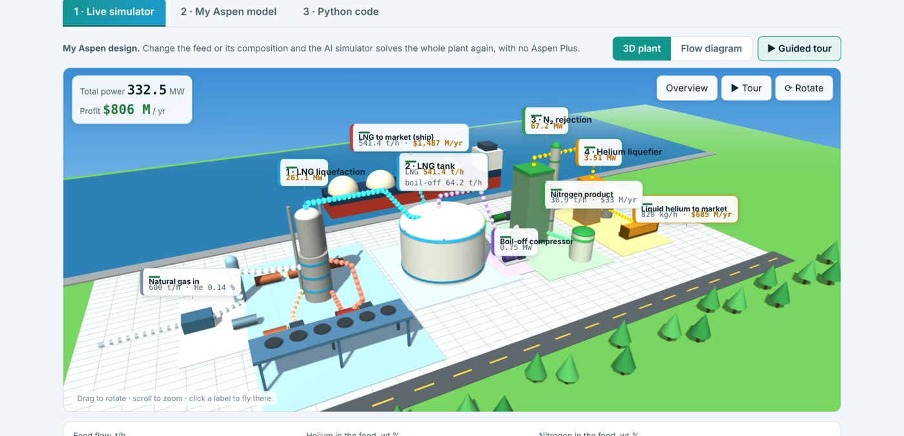
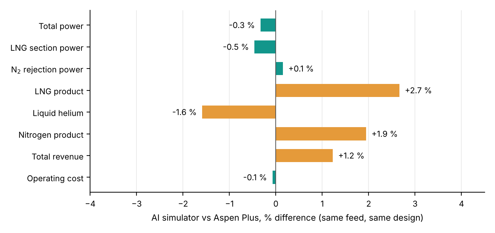
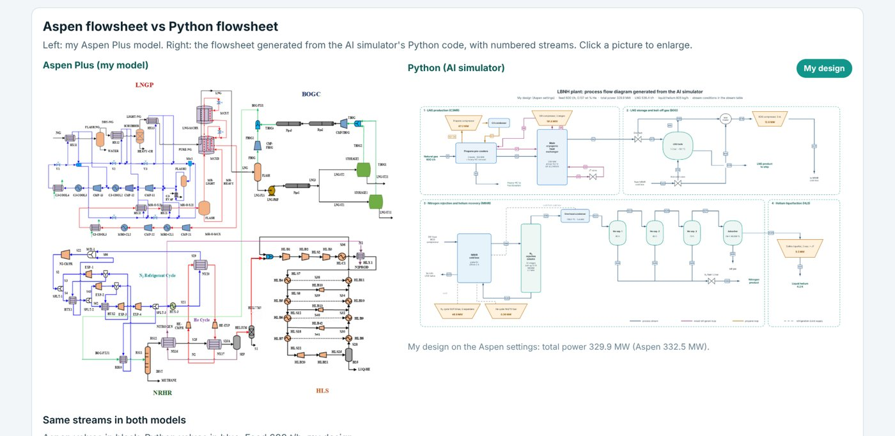
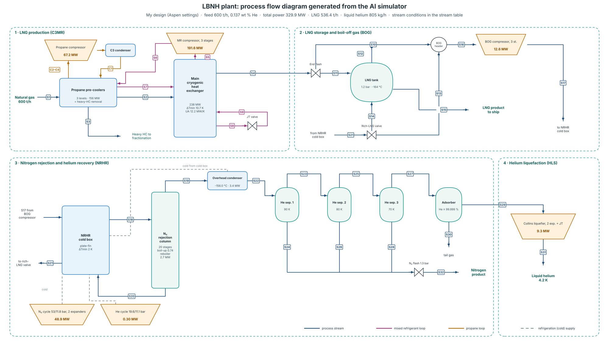

# Can AI take Aspen out of the loop?

**An AI-built Python simulator of an LNG plant with helium recovery and liquefaction, validated against Aspen Plus**

Ripa Sutar · PhD student, Chemical Engineering, Lamar University · INEN 6301 course project (2026)



## The question

Aspen Plus is the standard tool for process simulation, but it needs a costly licence, it is complex to learn, and every new feed or price scenario means converging the whole flowsheet again. My LNG plant with boil-off-gas (BOG) helium recovery took me more than five months to build in Aspen.

This project asks: **can an AI model build a working process simulator that replaces Aspen in the design loop?** Using Claude (Anthropic), the plant was rebuilt as an open Python simulator and checked stream by stream against my Aspen model.

## The plant

600 t/h natural gas (0.137 wt % helium, 7.63 wt % nitrogen), four sections:

1. **LNG production:** propane pre-cooled mixed refrigerant (C3MR), LNG at −152 °C
2. **LNG storage and boil-off gas:** helium concentrates in the tank boil-off gas
3. **Nitrogen rejection and helium recovery:** cryogenic column, separators, adsorber (He ≥ 99.999 %)
4. **Helium liquefaction:** Collins cycle, liquid helium at 4.2 K

Products: LNG 541 t/h, liquid helium 820 kg/h, nitrogen 31 t/h. Helium is only 0.14 % of the feed but earns about **31 % of the revenue**.

## Key findings

| Finding | Result |
|---|---|
| **Same design as Aspen** | Total power **331.4 MW vs 332.5 MW (−0.3 %)**; every compressor within about 1 % |
| **Products and revenue** | LNG +2.7 %, liquid helium −1.5 %, nitrogen +1.9 %, revenue +1.2 % |
| **Blind build** (before any Aspen result was seen) | LNG 555.8 vs 541.4 t/h, helium 807 vs 820 kg/h; but power 192 vs 332.5 MW, because the AI chose its own pressures and efficiencies |
| **Speed** | Simulator built in hours instead of months; a new feed solved in **about 35 s**, without Aspen |
| **Stream-by-stream check** | 15 streams compared: 8 match Aspen; 7 differ because of layout choices, not errors |
| **Mass balance** | Every section closes within **0.01 t/h** |



### What-if results (full plant re-solved in Python)

| Case | LNG, t/h | Helium, kg/h | Power, MW | Profit, $M/yr | Change |
|---|---|---|---|---|---|
| My design (600 t/h, 0.137 wt % He) | 541.4 | 820 | 332.5 | 806 | – |
| Feed +10 % | 595.5 | 902 | 365.8 | 915 | **+13.5 %** |
| Feed −20 % | 433.1 | 656 | 266.1 | 588 | −27.1 % |
| Helium 0.22 wt % | 539.7 | 1,328 | 339.7 | 1,222 | **+51.6 %** |

Profit rises faster than the feed because the fixed operating costs (maintenance, labour, insurance) are spread over more product. The helium share of revenue changes clearly only with the feed composition (31 % → 42 % at 0.22 wt % helium).

### Can AI take Aspen out of the loop? Not totally

**How AI helps**
- Builds the simulator fast: hours, not months
- Full control of the equations: open, readable code
- Can use property models Aspen does not have (here, helium fitted to GERG-2008)
- Easy what-if studies: a new feed in about 35 s
- Matches Aspen within 0.3 % on power

**Drawbacks: where Aspen is still needed**
- **Economics:** revenue, operating cost and capital come from my published (Aspen-based) analysis; the AI does not size or cost equipment, so a trustworthy economic optimization still needs Aspen
- **It needed a trusted reference:** the blind design differed by more than 40 % in power; agreement came only after my Aspen settings were given
- **Layout differences** in the storage and helium sections
- **Steady state only; no equipment rating**
- **AI-written code must be reviewed** by an engineer

> **Takeaway:** AI can build a process simulator from a clear process description and trusted references, but the engineer must analyze and validate the results.

## How the simulator was built (and how to check it did not copy Aspen)

1. **Blind build.** Only the paper's feed table, block diagram, technologies and property method were given. Every other number is in [`design_basis.py`](simulator/design_basis.py), labelled GIVEN / CHOSEN / TYPICAL. The predictions were sealed with a SHA-256 hash before any Aspen result was seen ([`predictions_sealed.json`](simulator/predictions_sealed.json)).
2. **Same-design check.** My Aspen settings were given as **inputs only** ([`aspen_settings.json`](simulator/aspen_settings.json)); Python computes the power itself.
3. **What-if studies.** For a new feed, Python re-solves the whole plant.

Check it yourself:
- `certutil -hashfile predictions_sealed.json SHA256` (Windows) or `sha256sum predictions_sealed.json` must match `predictions_sealed.sha256`
- Change any value in `aspen_settings.json` and run `python same_design.py`: the power changes
- The thermodynamics, flash, column, exchanger and liquefier code contain no Aspen results



## Inside the code

17 Python files, about 3,900 lines, open-source libraries only (NumPy, SciPy, CoolProp). No Aspen inside.

| Task | Method |
|---|---|
| Mixture thermodynamics | Peng–Robinson, helium fitted to GERG-2008 |
| Flash, bubble and dew points | Rachford–Rice with stability test |
| Nitrogen rejection column | Naphtali–Sandholm simultaneous Newton |
| Boil-off recycle | Tear stream with Wegstein acceleration |
| Pure N₂ and He | CoolProp reference equations of state |
| Heat exchangers | Composite curves, minimum approach, UA |



## Run it

```bash
cd simulator
pip install -r requirements.txt
python live_app.py          # opens the live simulator at http://localhost:8765
python same_design.py       # every Aspen compressor recomputed by Python (about 1 s)
python change_feed.py 660 0.137 7.63   # solve the whole plant for another feed
```

On Windows you can double-click `1_INSTALL.bat`, then `5_LIVE_SIMULATOR.bat`.
Without Python, open [`docs/index.html`](docs/index.html) in a browser (stored results).

## Documents

- [Project report (PDF)](docs/Project_Report.pdf)
- [Simulator guide, 15 slides (PDF)](docs/Simulator_Guide.pdf)
- [Flowsheet and stream table (PDF)](docs/Flowsheet_and_stream_table.pdf)

## Acknowledgements

Thanks to Dr. Curry for suggesting the idea for this course. The simulator was written with Claude (Anthropic) under my direction; all results were checked against my Aspen Plus model.

## Citation

If you use this work, please cite the original plant design: R. Sutar, Modi and Xu, *Industrial & Engineering Chemistry Research* (LNG production with boil-off-gas helium recovery and liquefaction), and this repository (see [`CITATION.cff`](CITATION.cff)).
